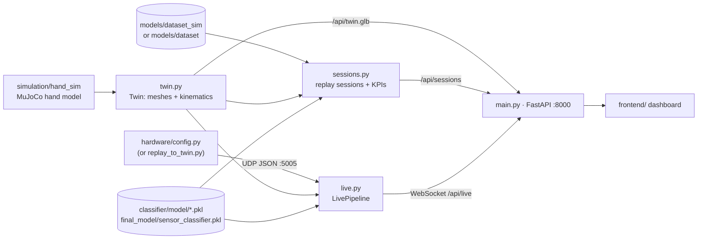

# `backend/`: dashboard backend (FastAPI + MuJoCo digital twin)

Frontend: [frontend.md](frontend.md)

The backend powers the web dashboard. It builds a **3D digital twin** of the hand from the MuJoCo
model in `simulation/`, serves **recorded sessions** for replay and turns the **live stream from
the real hand** into frames for the dashboard.

## How it fits together



## Files

| File | What it does |
|---|---|
| `src/main.py` | FastAPI app and endpoints. On startup it builds the twin, indexes the sessions and starts the UDP listener |
| `src/config.py` | Paths (relative to the repo root) and every setting, mostly overridable with env vars |
| `src/twin.py` | `Twin`: loads the MuJoCo hand from `simulation/hand_sim`, exports its visual meshes as GLB (one node per body) and computes body poses per frame. Also fits the object against the real grasp |
| `src/sessions.py` | Lists and loads replay sessions from the dataset folder; Sensor A/B classifiers; KPIs |
| `src/live.py` | `LivePipeline`: hand GUI UDP frames → twin pose, Sensor A/B estimate, object pose, grip force, slip |
| `cache/twin_right.glb` | Cached twin meshes. Rebuilt automatically if missing |
| `requirements.txt` | Pinned packages: fastapi, uvicorn, mujoco, numpy, scipy, pandas, trimesh, scikit-learn 1.9.1, xgboost 3.2.0, ... |
| `Dockerfile` | Python 3.11 image. **Build from the repo root**, because it copies `simulation/` and `classifier/model/` |
| `src/schemas.py`, `src/logger.py`, `src/layers/` | Empty placeholders |

## API

| Endpoint | Returns |
|---|---|
| `GET /api/health` | `{ok, dataset, sessions}`: a quick check that the backend is up |
| `GET /api/sessions` | List of replayable sessions |
| `GET /api/sessions/{id}` | One session, frame by frame, with twin poses and KPIs |
| `GET /api/twin.glb` | The hand (and objects) as a binary glTF |
| `GET /api/live/status` | Status of the live UDP stream |
| `WS /api/live` | Every new live frame (about 20 Hz), plus a status message every second |

## Running

**With Docker** (from the repo root; starts the frontend as well):

```bash
docker compose up --build        # backend on :8000, UDP on :5005, dashboard on http://localhost:3000
```

The compose file mounts `models/` read-only into the container, so the datasets aren't baked into the image.

**Without Docker** (from the repo root, with the venv activated):

```bash
python -m uvicorn backend.src.main:app --port 8000
```

Check http://127.0.0.1:8000/api/health. Then start the frontend (see `docs/documentation/frontend.md`).

## Live data

1. Start the backend.
2. Start `python hardware/config.py` with the real hand, **or** `python hardware/replay_to_twin.py 20261016_204513 --loop` without it.
3. Both send JSON datagrams to `127.0.0.1:5005`.

Each message carries `t`, `seq`, `dof`, `angle[6]` (0–1000), `angle_deg`, `state`, `slip` and `frozen`.
These optional fields are used when present:
- `force_act[6]`: grip-force KPI
- `tactile {group: {sum, max, contacts, cy, cx, force}}`: needed for the object estimate
- `hand_side`, `ip`

What `live.py` computes per frame:

| Output | How |
|---|---|
| Hand pose | MuJoCo forward kinematics from the joint angles. The right-hand model is mirrored for the left hand |
| Sensor A/B | `LIVE_SENSOR_MODEL=hold_mean` (default): `final_model/sensor_classifier.pkl` on the running mean of the grasp's settled hold frames, one estimate per grasp. `per_frame`: `xgb_sensor<LIVE_CLASSIFIER_SUFFIX>` with a majority vote |
| Object pose | Fitted against the real grasp: against the palm, where the fingers touch it at the measured angles, plus a photo calibration (`LIVE_GRASP_OFFSET`). The twin's fingers stop at the object's surface |
| Slip | The hand GUI's own slip detector result |

## Settings (env vars, see `src/config.py`)

| Variable | Default | Meaning |
|---|---|---|
| `DATASET_DIR` | `models/dataset_sim` | Folder with replay sessions (compose: `DATASET=dataset` for the real recordings) |
| `TWIN_HAND_SIDE` | `right` | Hand model for replay |
| `CLASSIFIER_SUFFIX` | `_sim` | Sensor A/B model for replay |
| `LIVE_UDP_HOST` / `LIVE_UDP_PORT` | `0.0.0.0` / `5005` | Where the live stream is received |
| `LIVE_HAND_SIDE` | `left` | Hand used live (the right hand is out of service) |
| `LIVE_SENSOR_MODEL` | `hold_mean` | `hold_mean` or `per_frame` (see above) |
| `LIVE_CLASSIFIER_SUFFIX` | `_combined` | Model for `per_frame` |
| `PREDICT_AFTER_HOLD_S` | `1.0` | Seconds in HOLD before predicting |
| `POS_MAX_OFFSET_MM` | `0` | How far the sim-trained position model may shift the fitted pose |
| `LIVE_FINGER_CLAMP` | `1` | Stop the twin's fingers at the object surface |

## Notes

- On Docker Desktop (Windows and macOS), a broadcast to `255.255.255.255` doesn't reach the container. Send to `127.0.0.1` (the default) or to this machine's address.
- One `MjData` is shared between requests and guarded by a lock, so session loads are serialised and cached (the last 32).
