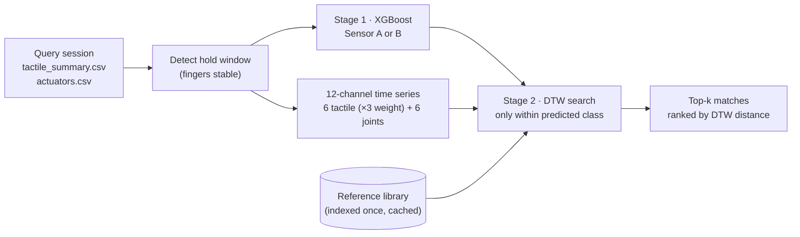

# `final_model/`: two-stage session matcher (the team's final model)

Author's notes: [README.md](../../final_model/README.md)

Given an **unknown grasp session**, this model:

1. **identifies the object**: Sensor A (VEGABAR 29) or Sensor B (VEGABAR 38)
2. **finds the most similar recorded grasp** of that object in a reference library

The best match tells you how the object was most likely held, because the library sessions are
known grasps.

## How it works



- **Hold window:** the longest stretch where every finger moves less than 20 units per frame. If none is found, the middle 50% of the session is used.
- **Stage 1:** XGBoost on the mean tactile and joint features over the hold window.
- **Stage 2:** multivariate Dynamic Time Warping (`dtaidistance`) on the hold window. Each channel is down-sampled to 60 frames or fewer and z-scored. The tactile channels count 3× so that the contact pattern matters more than the hand pose.

## Files

| File | What it is |
|---|---|
| `match_session.py` | Entry point |
| `sensor_classifier.pkl` | XGBoost model + scaler + feature list + label encoder (trained on 33 labelled real sessions) |
| `library_index.pkl` | Created on the first run: cached labels and series of the library. Not committed |
| `README.md` | Author's notes and example output |

The DTW helpers are imported from [`../matcher/match_session.py`](../../matcher/), so keep both folders.

## Running

From the repo root:

```bash
python final_model/match_session.py <query_session> --lib <library_dir> [--top 5] [--rebuild-index]
```

| Argument | Meaning |
|---|---|
| `query` | Session folder to identify |
| `--lib` | Folder of reference sessions. **The default is a path on a teammate's PC** (`~/Documents/20261017_17October_8pm`), so always pass your own |
| `--top` | Number of matches to show (default 5) |
| `--rebuild-index` | Re-index the library. Use it after adding sessions **or changing `--lib`** |

Example using the repo's own real recordings as the library:

```bash
python final_model/match_session.py models/dataset/20261016_204609 --lib models/dataset --top 3 --rebuild-index
```

The query is part of that library, so it matches itself first, with a DTW distance of about 0. The
ranks after it are the useful part.

## Accuracy

These are the authors' leave-one-out results on 33 labelled real sessions:

| Stage | Accuracy |
|---|---|
| Stage 1: object identity | 81.8% (27/33) |
| Stage 2: DTW within the correct class | 100% |
| End to end | **81.8%** |
