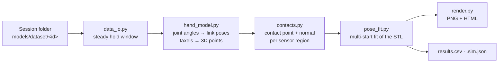

# `pose/`: tactile pose pipeline

Detailed notes from the author: [README.md](../../pose/README.md)

This pipeline estimates the **3D pose of the held object** from a recorded grasp using geometry
only, with **no machine learning**. It turns the tactile readings into 3D contact points on the
hand, then fits the object's CAD model (STL) so it touches those contacts without passing through
the fingers.

> Run every script **from inside `pose/`**, because the modules import each other as `import config`.

## Pipeline



## Files

| File | What it does |
|---|---|
| `run_pipeline.py` | **Entry point.** Runs the whole pipeline for one or all labelled sessions |
| `config.py` | All settings: hand side, data folder, tactile layout, thresholds, session → object labels |
| `data_io.py` | Loads a session and picks the frames where the hand is closed and pressure is near its peak |
| `hand_model.py` | Inspire hand kinematics from the URDF, and ray-casting of each taxel grid onto its link surface |
| `contacts.py` | Pressure-weighted 3D centroid and surface normal per active sensor region |
| `pose_fit.py` | Least-squares fit from several starting poses: contacts on the surface, normals opposed, no hand penetration |
| `render.py` | Static PNG and interactive Plotly HTML of hand, object, taxels and contacts |
| `compare_view.py` | Renders the result from the same viewpoint as the photos of the real grasps |
| `synthetic_test.py` | Known pose → fake contacts → fit → error. A check of the fitter |
| `eval/labels.py` | Photo labels (object end direction) for 13 real grasps |
| `eval/evaluate.py` | Scores the pose fit against those photo labels |
| `inspire_hand/` | Left and right hand URDFs and meshes (dex-urdf, CC BY-NC-SA 4.0) |
| `objects/` | `vegabar29.stl`, `vegabar38.stl` |
| `output/` | Results: `vegabar29/`, `vegabar38/`, `auto/` |
| `*.patch` | Patch files left over from development (left hand, palm fix). Not needed to run anything |

## Running

```bash
cd pose
python run_pipeline.py --session 20261016_204637        # one session; object picked from its label
python run_pipeline.py                                  # every labelled session
python run_pipeline.py --object vegabar29 --session 20261016_204513   # force an object
python synthetic_test.py                                # check the fitter
python eval/evaluate.py                                 # score against photo labels (~1 min per session)
python compare_view.py --session 20261016_204513 --object vegabar29
```

By default the pipeline reads sessions from `models/dataset/` (`LOG_DIR` in `config.py`). Two more options:
- `--log-dir <folder>` reads from another folder, for example `../hardware/logs`.
- `--hand left|right` says which hand recorded the logs.

## Outputs (`output/<object>/`)

| File | Contents |
|---|---|
| `<session>.png` | Static picture of hand + fitted object |
| `<session>.html` | Interactive 3D view. Open it in a browser and rotate with the mouse |
| `<session>.sim.json` | Pose in a format the simulation can replay |
| `results.csv` | One row per session: position, axis, `T_hand_obj`, `T_hand_cad`, fit quality, slip |

Meaning of the main result columns:
- `pos_*_mm`, `axis_*`: object centre and long axis, in the `hand_base_link` frame.
- `T_hand_cad`: 4×4 pose of the original CAD frame. Use this one for placement.
- `status`: `ok` (fit RMS < 2 mm and a unique solution), `poor fit` or `ambiguous`.

To replay a result in the simulation:

```bash
cd simulation
python -m hand_sim.run --pose ../pose/output/vegabar38/20261016_204609.sim.json
```

## Limits and settings to check

- Several values in `config.py` are marked **PLACEHOLDER** and should be checked against the hardware before you trust the results:
  - the tactile layout (`REGION_LAYOUT`, `ROW0_AT_TIP`, `PALM_*_RANGE`)
  - the angle mapping (`RAW_OPEN`, `DOF_TO_JOINT`)
  - `HAND_SIDE`, which is `left` because the right hand has been out of service since 17 Oct
- `PALM_FIX_LAYOUT` (default `False`) re-orders the palm grid into its true physical layout.
- Rotation about the object's own long axis, and position along it, can only be observed where the shape changes (thread, hex, connector). In the synthetic test, the axis is within about 1–6° and the lateral position within 2 mm, but the error along the axis reaches about 9 mm.
- One session takes about 20 s.
